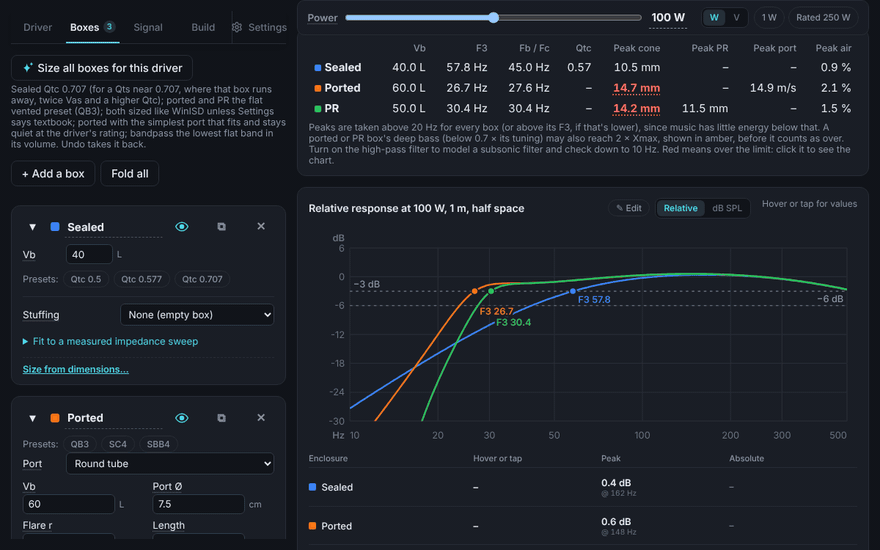

# Speaker Box Genius

**A free, browser-based loudspeaker enclosure simulator: a modern replacement for WinISD and Hornresp.**

Design sealed, ported, passive radiator, bandpass and transmission line boxes for any driver, see straight away whether the cone, the passive radiators or the port run out of headroom, then share the live design with a link instead of a pile of screenshots.

**Try it: https://speakerboxgenius.com**



Everything runs in your browser. There's nothing to install, no account and no server, and it keeps working offline. It works on phones as well as computers.

> 🚧 **Early preview.** It's usable and tested, but still changing quickly. The plan lives in [`docs/build-plan.md`](docs/build-plan.md).

## Features

- **Design assistant:** say what you're building (car sub, home sub, hi-fi woofer, tower…), your limits (box size, amplifier power and minimum load, number and size of drivers, box types, brands) and what matters most (deepest, loudest, smallest, balanced). It tries every suitable driver in the database in a sealed and a ported box sized the way the presets would (with a plain, flared or slot port that fits), and, for the best few drivers, mass-loaded and classic transmission lines (towers) or 4th- and 6th-order bandpass boxes (subwoofers); it simulates them at your power, grades them on any amp (deep bass below 0.7 × the tuning in amber, not failed), and ranks them; one tap starts your project with a result (or with the same driver in two boxes). New projects, and your first visit, start here.

### Box types

- **Sealed**, **ported** (vented) and **passive radiator** boxes
- **4th- and 6th-order bandpass**, each chamber with its own port or passive radiators
- **Transmission lines**: open lines, mass-loaded lines, **tapped horns** and **front-loaded horns**, built from tapered sections (parallel, conical or exponential), with stuffing, the driver anywhere along the line and a drawing of the folded box. Presets and **Compare types** cover every type but the tapped horn, whose starting point is being reworked; set one up by hand or import it from Hornresp
- **Stuffing** per sealed, ported or passive radiator design: lined walls, a fibre fill by weight (g/L or lb/ft³, with the grams to weigh out) or your own measured values, so an empty and a stuffed box can sit on one chart; **fit to a measured impedance sweep** (.zma) finds the volume a finished box really acts as and its Qa
- Up to **8 designs side by side** on the same charts, each easy to switch on or off, rename or duplicate

### Charts

- **SPL**, relative or absolute (dB SPL), with each design's **F3** marked
- **Cone excursion** with an **Xmax redline**, and **passive radiator excursion** with each PR's own Xmax
- **Port air velocity** with a **chuffing-risk line** (peak or RMS; 17 m/s by default, your own in Settings → Ports, used by every check and the design assistant)
- **Box pressure**: the peak sound pressure inside the box (both chambers of a bandpass), the load on the cone and the walls; matches Hornresp's diaphragm pressure chart
- **Maximum SPL**: the loudest each box can play at every frequency, with a band showing what limits it there (Xmax, PR Xmax, port speed or thermal power), and the **amplifier voltage and current** needed to reach it, after the filter and EQ
- **Impedance**, **group delay**, and **line load (Za)** for lines and horns
- For lines: the **cone and mouth** contributions on their own, and **pressure and air speed along the line** at any frequency, showing where stuffing does the most
- **Edit on the chart:** drag a ported or PR box's tuning, or an EQ point (frequency, gain; tap it for Q and Remove), on the response chart, with mouse, finger or keyboard; Cancel puts everything back as it was
- Over-limit parts of a curve glow red; hover or tap for the values of every curve at that frequency, with the **leading curve marked** (highest SPL, lowest excursion, and so on)
- Phone-friendly: tall charts, a legend under each chart, one chart at a time, and a strip of every box's F3 and limits pinned above the controls
- Every warning leads somewhere: tap "over a limit" (or a red value) to jump to the chart that shows it, or a port warning to the field that fixes it

### Drivers

- **A T/S parameter editor that never overwrites what you typed.** Type any set of parameters in any order; the rest are calculated (shown in grey), and contradictions are flagged
- **Paste straight from a datasheet**: the parameters are picked out of the text, with units like "1.9 ft³" or "35630 mm²" converted
- **A driver database of about 1,530 drivers from 18 brands**, plus 55 passive radiators, searchable and filterable, with links to each manufacturer's datasheet. Values that look wrong for a driver (an Xmax too large for its cone, say) are marked "check" until someone confirms them against the datasheet, and the design assistant leaves those drivers out
- **A page for every driver** on the site ([speakerboxgenius.com/drivers](https://speakerboxgenius.com/drivers/)), with suggested sealed, ported and passive radiator boxes (none over 300 L) at the driver's power rating, their charts, and a link that opens them in the app
- **Compare with another driver**: a second driver drawn dashed in every box, with **Swap** to make it the main one
- **Multiple drivers**: any number, wired in series or parallel, **isobaric** pairs and **dual voice coil** drivers
- **Measure your own driver** from a free-air impedance sweep (DATS, REW, ARTA and others, as `.zma`, `.txt` or `.csv`), with an added-mass sweep for Vas
- Voice-coil inductance models (Le, and L2R2 for a closer match to measurements), and a **hot voice coil** setting for power compression
- **Import and export WinISD** `.wdr` drivers and `.wpr` projects (open any sealed, ported, PR or ported bandpass box in WinISD), **import OpenISD** `.owpr` projects and `.owdr` drivers, and send a driver to the database from the app

### Sizing and tuning

- **Alignment presets**: Qtc 0.5, 0.577 and 0.707 for sealed boxes; QB3, B4 and Keele for ported ones; one tap sizes every box for the driver (sealed at Qtc 0.707, or twice Vas when Qts is so close to 0.707 that the box would run away) and picks each port: the simplest that fits and stays under the chuffing line at the driver's rated power
- **Find a passive radiator**: tries every PR in the database (and, optionally, woofers used as PRs) in groups of 1, 2 or 4, tunes each with added mass and ranks them by bass extension and spare travel
- **Best PR tuning**: the added mass for the flattest response, the deepest bass or the smallest box for a target F3
- **Port fit checks**: the port length for a tuning, whether it fits inside the box, round or slot ports, flared ends, and an option to model ports as pipes (with their own resonances)
- **Tune a line** by its length (or its port, for a mass-loaded line) to a target frequency

### Signal and room

- **Drive by power or voltage** (W or V, e.g. 2.83 V for datasheet comparisons). New projects start at 1 W, like WinISD and Hornresp, with one tap for 1 W or the driver's rated power
- **High-pass filter** (Butterworth 6–24 dB/oct or Linkwitz–Riley 12 and 24 dB/oct), **Linkwitz Transform**, peaking, low-shelf and high-shelf **EQ** (matched with Hornresp)
- **Passive parts** between the amplifier and the drivers: series coils (with their resistance), capacitors across, Zobels and L-pads, in up to four branches (Hornresp's layout); the impedance chart shows what the amplifier sees
- **Car cabin or room gain**, or **your own room-gain curve** (.txt or .frd, as Hornresp imports it), and **baffle step** for free-standing speakers

### Volume and build

- **Real-world net volume calculator** for boxes, cylinders, spheres and truncated pyramids, minus the drivers, passive radiators, ports, bracing and crossover board, linked to a design so its volume follows the calculator
- **Build sheet**: panel sizes, cutouts, port and braces, a **cut list laid out on stock sheets**, metric or imperial (to 1/16″), and a print view

### Sharing and projects

- **Shareable links**: the whole simulation lives in the URL, so a link opens exactly what you see
- **Forum image** with the summary, charts and a **QR code** to the live design, plus ready-to-paste **Reddit (Markdown)** and **diyAudio (BBCode)** posts
- **CSV export** of every curve
- **Hornresp import and export** for transmission lines and horns
- **Projects** saved in your browser, or as a `.json` file you can keep or send, from the ☰ menu (with **New project**, which starts in the design assistant, in a new tab if the current project is in use)
- Undo and redo, and help on every input field (hover its label, or select the field)
- Installable as an app on phones and computers

### Settings

- **Metric or imperial** units
- **WinISD mode** (its air constants, peak or RMS port speed) and **Hornresp mode** (its air constants, SPL from radiated power), for like-for-like comparisons
- **Your own air**: temperature, humidity and pressure (for altitude or a hot car), which set the air's density and speed of sound
- Box losses (Ql, Qa, Qp) and amplifier resistance

## Accuracy

Results are checked against the established tools, and every comparison runs as an automated test:

- **WinISD**: within 0.01 dB for sealed and ported boxes. Passive radiator boxes match WinISD's tuning; at the tuning peak the response can differ by up to about 0.5 dB, because WinISD damps the radiator differently (explained on the validation page). Also checks for bandpass, isobaric, dual voice coil, parallel drivers, high-pass filters and leakage. See the [validation page](https://speakerboxgenius.com/validation/).
- **Hornresp**: transmission lines, tapped horns and front horns, including impedance and the line load (Za); and sealed, ported, passive-radiator and bandpass boxes, with one or two drivers. See the [validation page](https://speakerboxgenius.com/validation/#hornresp) and [`docs/transmission-lines.md`](docs/transmission-lines.md).

The model is small-signal and lumped (one-dimensional for lines). Port compression and a hot voice coil are optional estimates in Settings; Bl and Cms non-linearity aren't modelled.

## The driver database

The database lives in this repo, in [`drivers/`](drivers) and [`passive-radiators/`](passive-radiators): about 1,530 drivers and 55 passive radiators. Sources and credits are in [`docs/data-sources.md`](docs/data-sources.md). Every driver with enough parameters also gets a page on the site with suggested sealed, ported and passive radiator boxes: [speakerboxgenius.com/drivers](https://speakerboxgenius.com/drivers/). It isn't affiliated with or endorsed by any manufacturer. Spotted a mistake? [Ask for a correction or removal](../../issues/new?template=data-correction.yml).

## Contributing

There are two ways to help:

1. **Add drivers and passive radiators.** No coding needed. Use the [new driver form](../../issues/new?template=new-driver.yml) and copy the numbers from the manufacturer's datasheet. See [`drivers/README.md`](drivers/README.md).
2. **Work on the code.** See [`CONTRIBUTING.md`](CONTRIBUTING.md). Code and docs contributions need a one-time [Contributor License Agreement](CLA.md), signed with a comment on your first pull request; adding drivers doesn't.

## Development

Requires Node.js 22.6+ and pnpm 10. The repo has four packages: `packages/engine` (the simulation, plain TypeScript), `packages/web` (the React app), `packages/schema` (data formats) and `packages/db-tools` (database checks, bundling and imports), plus `site/` (the guides, validation page and driver pages).

```bash
pnpm install
pnpm validate:db   # check every driver / PR file
pnpm db:review     # list values that look implausible, with datasheet links
pnpm test          # engine, database and app tests
pnpm dev           # run the web app locally
pnpm build         # production build (what GitHub Pages serves)
```

`pnpm build` also builds the content pages (`site/`): the guides, the validation page and a page per driver. Each driver page gets a share card drawn with headless Chrome, found at `CHROME_PATH` or the usual install paths; set `SBG_CARDS=0` to skip them (CI does).

Merging to `main` builds and deploys to GitHub Pages automatically.

## Licence

Speaker Box Genius is **free and source-available for non-commercial use**. It is not "open source" in the OSI sense, because it doesn't allow commercial resale.

- **Code**: [PolyForm Noncommercial 1.0.0](LICENSE). Use it, change it and share it for personal, hobby, educational or non-profit purposes. Selling it or using it in a paid product needs permission.
- **Driver database and docs**: [CC BY-NC-SA 4.0](LICENSE-DATA), except a few brands that allowed use here but not under Creative Commons (listed in LICENSE-DATA).

The aim is simple: it was built by the community, so it stays free for the community.
